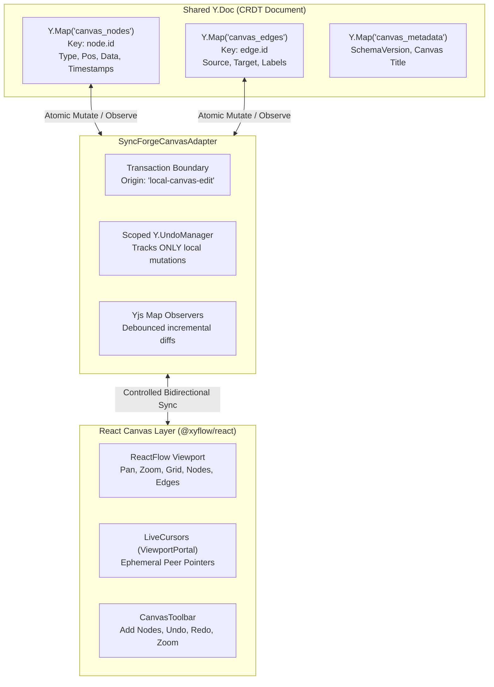
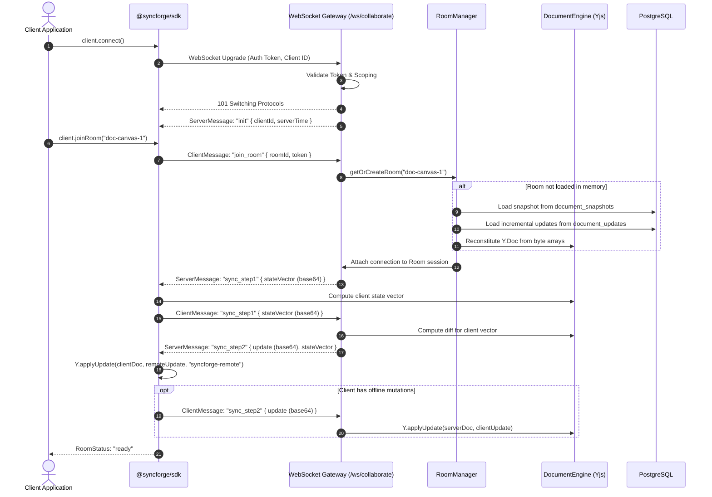
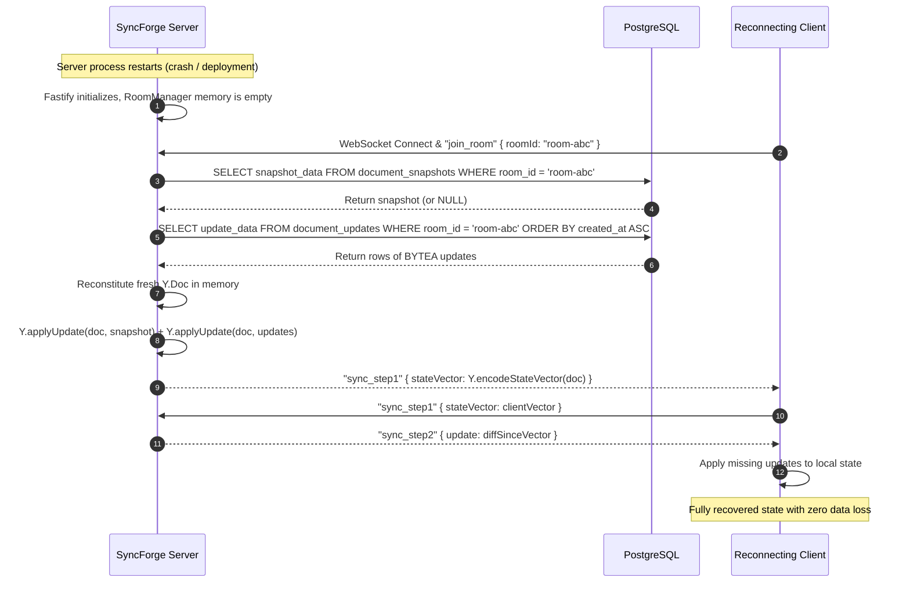

# SyncForge System Architecture Specification

## 1. Executive Overview

**SyncForge** is real-time collaboration infrastructure designed for software engineers and SaaS teams. It eliminates the need to build custom WebSocket synchronization servers, distributed state mergers, and presence trackers from scratch.

SyncForge is architected as a modular TypeScript monorepo with distinct component boundaries:

- A shared protocol and schema specification (`@syncforge/shared`).
- A public TypeScript client SDK (`@syncforge/sdk`).
- A high-performance Fastify gateway and synchronization server (`apps/server`).
- A Next.js developer portal, dashboard shell, and interactive canvas demo (`apps/web`).
- Durable PostgreSQL storage and Redis coordination primitives.

---

## 2. High-Level Topology

```mermaid
flowchart TB
    subgraph ClientLayer["Client Layer (Applications & SDK)"]
        AppA["Web Application A\n(@syncforge/sdk)"]
        AppB["Web Application B\n(@syncforge/sdk)"]
        Dashboard["SyncForge Console\n(apps/web)"]
    end

    subgraph GatewayLayer["Gateway & Server (apps/server)"]
        Fastify["Fastify 5 Server\n(Port :4000)"]
        Routes["HTTP Routes\n/healthz, /readyz, /api/v1/info"]
        WSTransport["WebSocket Transport\n/ws/collaborate (@fastify/websocket)"]
        AuthService["Auth & Scoping Service\n(Token & Project Verification)"]
    end

    subgraph EngineLayer["Collaboration Engine (Implemented Phase 1)"]
        RoomManager["RoomManager\nLifecycle, Concurrency Locks, Idle Eviction"]
        RoomInstance["Room Instance\nConnected Sessions, Broadcast with Exclusion"]
        DocumentEngine["DocumentEngine (Yjs)\nCRDT State Vector & Delta Merging"]
    end

    subgraph PersistenceLayer["Durable Persistence Service"]
        PersistenceService["PersistenceService\nBounded Queue, Batch Flush, Compaction"]
        Postgres[("PostgreSQL 16\ndocument_updates (BYTEA)\ndocument_snapshots (BYTEA)\nrooms & projects")]
        Redis[("Redis 7\n(Planned Phase 3 Pub/Sub)")]
    end

    AppA <-->|WSS (SyncForgeClient)| WSTransport
    AppB <-->|WSS (SyncForgeClient)| WSTransport
    Dashboard <-->|HTTPS| Routes

    Fastify --> Routes
    Fastify <--> WSTransport
    WSTransport --> AuthService
    WSTransport <--> RoomManager
    RoomManager --> RoomInstance
    RoomInstance <--> DocumentEngine
    RoomInstance -->|Buffer Edits| PersistenceService
    PersistenceService -->|Batch INSERT / Compaction| Postgres
    RoomManager -.->|Multi-Instance Coordination| Redis
```

---

## 3. Package & Service Responsibilities

### 3.1 `@syncforge/shared` (Shared Protocol & Schemas)

- **Status:** Phase 0 & Phase 1 Implemented.
- **Responsibilities:**
  - Standard protocol version (`1.0.0`).
  - Strict discriminated union schemas for all client and server messages (`ClientMessageSchema`, `ServerMessageSchema`).
  - Cross-platform binary encoding utilities (`bytesToBase64`, `base64ToBytes`) for lossless Yjs binary wire transport.
  - Standard WebSocket close codes (4001 Unauthorized, 4004 Room Not Found, 4005 Rate Limited, 4006 Max Payload, 1001 Going Away).
  - Strongly typed error codes and definitions (`SYNCFORGE_ERROR_CODES`).

### 3.2 `@syncforge/sdk` (Public Client SDK)

- **Status:** Phase 1 Client & Room Synchronization Implemented.
- **Responsibilities:**
  - `SyncForgeClient`: Universal client supporting modern browsers and Node.js (`ws`).
  - Automatic connection lifecycle management (`disconnected` -> `connecting` -> `connected` -> `reconnecting`).
  - Exponential backoff with random jitter on connection drop.
  - Room management abstraction (`client.joinRoom(roomId)`).
  - Bidirectional Yjs document binding with remote-origin tagging (preventing local echo loops).
  - Two-step state-vector sync handshake and real-time delta update streaming.
  - Automatic room resubscription and delta reconciliation upon network reconnection.

### 3.3 `apps/server` (Gateway & Sync Server)

- **Status:** Phase 1 Core Collaboration Engine Implemented.
- **Responsibilities:**
  - Fastify 5 server with `@fastify/websocket` gateway at `/ws/collaborate`.
  - Structured logging with Pino, request correlation IDs, and secret redaction.
  - Heartbeat tracking with ping/pong frames to detect dead client sockets.
  - Per-connection rate limiting and 64KB frame size validation.
  - `RoomManager`: Single-flight room instantiation locks, room eviction of idle sessions, graceful shutdown broadcasting.
  - `DocumentEngine`: Yjs CRDT operations, state vector computation, delta updates, and snapshot compilation.
  - `PersistenceService`: Buffer-managed, transactional PostgreSQL persistence storing raw byte arrays (`BYTEA`) and compacted snapshots.

### 3.4 `apps/web` (Collaborative Workspace & Developer Portal)

- **Status:** Phase 0 Portal & Phase 2 Collaborative Canvas Implemented.
- **Responsibilities:**
  - Next.js 15 App Router application with React 19, Tailwind CSS, and Lucide icons.
  - Interactive multi-user collaborative canvas workspace at `/rooms/[roomId]` powered by `@xyflow/react` and `@syncforge/sdk`.
  - Custom modular node components (`NoteNode`, `ProcessNode`, `DecisionNode`) with inline editing and connection handles.
  - Real-time pointer tracking with `LiveCursors` in React Flow's `ViewportPortal`.
  - Dynamic `PresenceRoster` showing active peer count, avatars, and participant profiles.
  - Connection lifecycle banner surfacing real network states (`connecting`, `syncing`, `synced`, `reconnecting`, `error`).

---

## 4. Collaborative Canvas Architecture & Graph Schema

The collaborative visual canvas is architected around a versioned, conflict-free shared graph model managed by `SyncForgeCanvasAdapter`:



### 4.1 Shared Document Schema

- **`canvas_nodes` (`Y.Map<CanvasNode>`)**:
  - `id`: Stable string identifier (`node_${timestamp}_${rand}`).
  - `type`: `'note' | 'process' | 'decision'`.
  - `position`: `{ x: number, y: number }` (finite floats).
  - `data`: `{ title: string, content: string, color?: string, status?: 'idle' | 'active' | 'completed' }`.
  - `updatedAt`: Epoch timestamp.
- **`canvas_edges` (`Y.Map<CanvasEdge>`)**:
  - `id`: Stable string identifier (`edge_${source}_${target}_${rand}`).
  - `source`: Source node ID.
  - `target`: Target node ID.
  - `sourceHandle` / `targetHandle`: Optional connection ports.
  - `label`: Optional connection label.
- **`canvas_metadata` (`Y.Map<unknown>`)**:
  - `schemaVersion`: 1
  - `title`: Canvas title.

### 4.2 Local Scoped Undo / Redo

SyncForge enforces a strict isolation boundary on `Y.UndoManager`:

- The UndoManager is initialized with `trackedOrigins: new Set(['local-canvas-edit'])`.
- When local users add, move, or edit nodes, the transaction is tagged with `'local-canvas-edit'`.
- Remote peer updates (applied with origin `'remote'` or `'sync'`) are **never** tracked.
- Therefore, when user A clicks "Undo", it reverts _only_ user A's previous local operation, completely preventing user A from inadvertently reverting user B's concurrent modifications.

### 4.3 Ephemeral Awareness & Cursor Protocol

Live cursors and presence are strictly transient state and are **never** persisted to the durable PostgreSQL database:

- Managed via `y-protocols/awareness` bound to `room.awareness`.
- Mouse movements on the canvas are mapped to flow coordinates using `screenToFlowPosition({ x, y })` and throttled to 50ms intervals (~20 updates/sec).
- Cursors are rendered inside `<ViewportPortal />`, so React Flow handles canvas pan, zoom, and matrix transforms natively without full graph re-renders.
- Disconnected or idle peers (inactivity > 30s) are automatically expired and unmounted.

---

## 5. Conflict Resolution & CRDT Model

SyncForge uses **Yjs** as its core Conflict-Free Replicated Data Type (CRDT) engine.

### 4.1 Why Yjs?

1. **Provable Eventual Consistency:** Independent concurrent edits are guaranteed to converge mathematically across all replicas without requiring locks or centralized arbitration.
2. **Compact Binary Encoding:** Mutations are serialized as highly compact binary diffs (`Uint8Array`), drastically reducing bandwidth compared to JSON-based Operational Transformation.
3. **Decoupled Transport:** Yjs separates CRDT document logic from the transport layer, allowing SyncForge to enforce authorization, persistence, rate limiting, and room lifecycle boundaries cleanly.

### 4.2 State Vector Sync Protocol

SyncForge implements the standard two-step CRDT state exchange:

1. **Sync Step 1:** Client sends its current state vector (`sync_step1`) to the room.
2. **Sync Step 2:** Room computes a differential binary update (`Y.encodeStateAsUpdate(doc, clientStateVector)`) representing all changes the client is missing, and replies with `sync_step2`. Room also includes its own state vector so the client can transmit any offline or uncommitted local mutations.
3. **Continuous Streaming:** Subsequent mutations trigger `doc_update` messages broadcast to all other room members, accompanied by a `doc_update_ack` to the originating client.

---

## 5. Collaboration Engine Sequence Diagrams

### 5.1 Client Connection and Room Join Handshake



### 5.2 Concurrent Document Edits & Broadcast

```mermaid
sequenceDiagram
    autonumber
    actor Alice as Peer Alice
    actor Bob as Peer Bob
    participant SDK_A as SDK (Alice)
    participant SDK_B as SDK (Bob)
    participant Server as SyncForge Server Room
    participant DB as PostgreSQL

    Note over Alice,Bob: Both peers connected to Room "doc-canvas-1"

    par Concurrent Edits
        Alice->>SDK_A: Mutate Shape A
        SDK_A->>SDK_A: Y.Doc emits "update"
        SDK_A->>Server: "doc_update" { update (base64) }
    and
        Bob->>SDK_B: Mutate Shape B
        SDK_B->>SDK_B: Y.Doc emits "update"
        SDK_B->>Server: "doc_update" { update (base64) }
    end

    Server->>Server: Apply Alice update to Y.Doc
    Server-->>SDK_A: "doc_update_ack" { updateId }
    Server-->>SDK_B: Broadcast "doc_update" { update (base64) }
    SDK_B->>SDK_B: Y.applyUpdate(doc, update, "syncforge-remote")

    Server->>Server: Apply Bob update to Y.Doc
    Server-->>SDK_B: "doc_update_ack" { updateId }
    Server-->>SDK_A: Broadcast "doc_update" { update (base64) }
    SDK_A->>SDK_A: Y.applyUpdate(doc, update, "syncforge-remote")

    Note over Alice,Bob: State automatically converges via CRDT determinism

    rect rgb(20, 30, 45)
        Note over Server,DB: Asynchronous Durable Persistence Buffer
        Server->>DB: INSERT INTO document_updates (room_id, update_data BYTEA)
    end
```



### 5.3 Document Recovery After Server Restart



---

## 6. Persistence & Data Model

### 6.1 PostgreSQL: Durable Source of Truth

PostgreSQL retains all persistent collaboration entities:

- `projects`: Tenant boundaries and workspace metadata.
- `api_keys`: SHA-256 hashed API credentials for SDK authentication.
- `rooms`: Collaborative room records mapped to projects.
- `document_updates`: Append-only binary updates (`update_data BYTEA`) ordered by `created_at`.
- `document_snapshots`: Compacted document state snapshots (`snapshot_data BYTEA`) with version numbers for accelerated cold starts.

### 6.2 Write-Buffering & Compaction

1. **Write-Through Buffering:** Edits are acknowledged immediately to in-memory peers while updates are enqueued to a bounded persistence queue with batch flushes.
2. **Snapshot Compaction:** Rooms that accumulate extensive delta logs can be compacted into a single snapshot update via `PersistenceService.compactRoom()`, pruning old incremental rows while preserving strict CRDT state.

### 6.3 Redis: Ephemeral State & Coordination

Redis is reserved for high-frequency operational state:

- Real-time cursor coordinates and presence timeouts (Phase 2).
- Inter-process communication when multiple server instances run behind a load balancer (Phase 3).
- Ephemeral rate-limiting counters.

Redis is **never** used as the single point of failure for durable document updates.

---

## 7. Trust Boundaries & Security Architecture

1. **Client to Gateway:** Untrusted boundary. All WebSocket frames are strictly validated with Zod schemas. Untrusted binary arrays are decoded before applying to CRDT documents.
2. **Authentication:** Cryptographic bearer tokens and API keys are validated during connection initialization and room join.
3. **Authorization:** Rooms are scoped to verified tenant projects. Unauthorized access attempts trigger `4001 Unauthorized` close frames.
4. **Data Isolation:** All database transactions and queries strictly scope updates by `room_id` and project boundaries.

---

## 8. Major Architectural Trade-Offs

| Decision                 | Chosen Approach                             | Alternative Considered        | Rationale                                                                                                             |
| :----------------------- | :------------------------------------------ | :---------------------------- | :-------------------------------------------------------------------------------------------------------------------- |
| **Monorepo Tooling**     | Native `npm workspaces`                     | Turborepo / Nx                | Minimal overhead, zero extra daemon processes, transparent CI portability across Windows and Linux.                   |
| **CRDT Engine**          | Yjs                                         | Automerge / Custom OT         | Yjs has the fastest binary encoding, smallest memory footprint in Node.js, and richest canvas ecosystem.              |
| **Backend Framework**    | Fastify 5                                   | Express / NestJS              | Fastify provides up to 3x higher throughput, native schema validation hooks, and low-latency WebSocket handling.      |
| **Database Migrations**  | Custom Transactional SQL Runner             | Heavy ORM migration daemons   | Complete control over PostgreSQL transactions, zero binary engine crashes on Windows, full SQL transparency.          |
| **Binary Protocol Wire** | Base64-encoded binary in JSON envelopes     | Pure binary framed protocol   | Combines ease of schema validation, routing metadata, and observability with lossless CRDT byte payload preservation. |
| **State Coordination**   | PostgreSQL (Durable) + Redis (Coordination) | Single Database / Memory only | Clean separation between durable write-ahead log and sub-millisecond cursor broadcasts.                               |

---

## 9. Production SDK & External Integration Architecture (Phase 3)

### 9.1 Zero-Monorepo Dependency Packaging

The `@syncforge/sdk` distribution is compiled into standalone dual-module packages (ESM and CommonJS) with TypeScript declarations. All `@syncforge/shared` protocol schemas, Zod validators, and binary helpers are inlined directly into `dist/index.js` using `tsup --no-external @syncforge/shared`. External consumers install `@syncforge/sdk` without needing access to private monorepo workspace packages.

### 9.2 Dynamic Token Lifecycle & Auth Handshake

To prevent storing long-lived credentials in client bundles, `SyncForgeClient` accepts an asynchronous `getToken` callback. This function is invoked during initial connection and prior to reconnection attempts, allowing integration with dynamic JWT issuers (OAuth2, Auth0, Clerk, Supabase, NextAuth).

### 9.3 React 19 Integration & StrictMode Resilience

The subpath export `@syncforge/sdk/react` provides `<SyncForgeProvider>`, `useSyncForgeRoom`, `useSyncForgePresence`, and `useSyncForgeStatus`. `useSyncForgeRoom` tracks component mount lifecycles with internal refs, guaranteeing that React 19 StrictMode double-mounting does not leak room subscriptions or duplicate WebSocket traffic.
