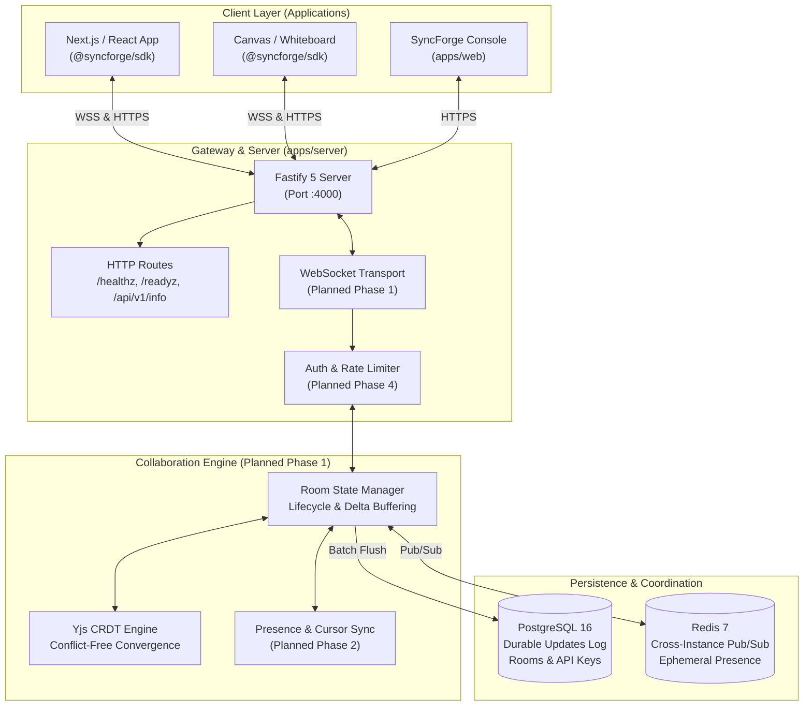

# SyncForge System Architecture Specification

## 1. Executive Overview

**SyncForge** is real-time collaboration infrastructure designed for software engineers and SaaS teams. It eliminates the need to build custom WebSocket synchronization servers, distributed state mergers, and presence trackers from scratch.

SyncForge is architected as a modular TypeScript monorepo with distinct component boundaries:

- A shared protocol and schema specification (`@syncforge/shared`).
- A public TypeScript client SDK (`@syncforge/sdk`).
- A high-performance Fastify gateway and synchronization server (`apps/server`).
- A Next.js developer portal, dashboard shell, and interactive canvas demo (`apps/web`).
- Durable PostgreSQL storage and Redis coordination primitives.

---

## 2. High-Level Topology

---

## 3. Package & Service Responsibilities

### 3.1 `@syncforge/shared` (Shared Protocol & Schemas)

- **Status:** Foundation Implemented.
- **Responsibilities:**
  - Standard protocol version (`1.0.0`).
  - Runtime validation schemas using Zod (`RoomIdSchema`, `UserPresenceSchema`, `ClientMessageSchema`, `ServerMessageSchema`).
  - Standard WebSocket close codes (4001 Unauthorized, 4004 Room Not Found, 4029 Rate Limited, etc.).
  - Unified error codes (`SYNCFORGE_ERROR_CODES`).
  - Zero dependency on frontend frameworks or server modules.

### 3.2 `@syncforge/sdk` (Public Client SDK)

- **Status:** Core Types & Interfaces Implemented (Phase 0).
- **Responsibilities:**
  - Client instance management (`SyncForgeClient`).
  - Connection lifecycle tracking (`disconnected` -> `connecting` -> `connected` -> `reconnecting` -> `error`).
  - Event subscriptions (`onConnectionStateChange`).
  - Room session abstraction (`joinRoom(roomId)`).
  - Strongly typed error handling (`SyncForgeError`, `ConnectionError`, `RoomError`).
  - Phase 1 integration target: Wiring Yjs WebSocket provider and binary document updates.

### 3.3 `apps/server` (Gateway & Sync Server)

- **Status:** HTTP Gateway, Health Probes, Schema, and Migration Runner Implemented. Full WS CRDT Planned for Phase 1.
- **Responsibilities:**
  - Fastify HTTP server with strict CORS, structured JSON logging (Pino), and request correlation IDs (`x-request-id`).
  - Liveness probe (`/healthz`) and dependency-aware readiness probe (`/readyz`).
  - PostgreSQL connection pool with transaction-safe migration runner (`syncforge_migrations`).
  - Redis connection client for pub/sub and distributed locking.
  - Phase 1 integration target: WebSocket upgrade handler, room attachment, and durable delta persistence.

### 3.4 `apps/web` (Developer Portal & Demo Shell)

- **Status:** Foundation Shell & Landing Experience Implemented.
- **Responsibilities:**
  - Next.js 15 App Router application with Tailwind CSS dark theme.
  - Interactive architecture explorer and SDK code block preview.
  - Live protocol validator for room identifiers.
  - Dashboard shell for project and API key management (Phase 4 target).
  - Collaborative canvas demonstration application (Phase 2 target).

---

## 4. Conflict Resolution & CRDT Model (Planned Phase 1)

SyncForge uses **Yjs** as its core Conflict-Free Replicated Data Type (CRDT) engine.

### Why Yjs?

1. **Proven Mathematical Convergence:** Ensures eventual consistency without centralized transaction locks.
2. **Compact Binary Updates:** Changes are encoded as differential byte arrays (`Uint8Array`), minimizing network overhead.
3. **Decoupled Transport:** Yjs separates CRDT document logic from the network layer, allowing SyncForge to enforce authorization and persistence boundaries cleanly.

### Document Sync Lifecycle:

1. **Room Initial State:** When the first peer connects to a room, the server reconstructs the Yjs document by querying all rows in `document_updates` for that `room_id`.
2. **Delta Propagation:** Subsequent peer edits are sent as incremental updates (`Y.applyUpdate`) and broadcast to room peers.
3. **Compaction:** Periodic background jobs compress hundreds of incremental updates into a single snapshot update to keep room load times fast.

---

## 5. Persistence & Data Model

### PostgreSQL: Durable Source of Truth

PostgreSQL retains all persistent collaboration entities:

- `projects`: Tenant boundaries and workspace metadata.
- `api_keys`: SHA-256 hashed API credentials for SDK authentication.
- `rooms`: Collaborative room records mapped to projects.
- `document_updates`: Append-only binary updates (`update_data BYTEA`) ordered by `created_at`.

### Redis: Ephemeral State & Coordination

Redis is strictly used for non-durable and high-frequency operational state:

- Real-time cursor coordinates and presence timeouts.
- Inter-process communication when multiple server instances run behind a load balancer.
- Rate-limiting counters.

Redis is **never** used as the single point of failure for durable document updates.

---

## 6. Trust Boundaries & Security Architecture

1. **Client to Gateway:** Untrusted boundary. All client payloads are validated against Zod schemas. Untrusted WebSocket messages are checked before invoking CRDT logic.
2. **Authentication:** Phase 4 will introduce cryptographically verified API tokens (`sf_live_...` or `sf_dev_...`).
3. **Authorization:** The server validates whether the requesting project has access to join or mutate the target `room_id`.
4. **Data Isolation:** All database queries scope rooms by `project_id`.

---

## 7. Major Architectural Trade-Offs

| Decision                | Chosen Approach                             | Alternative Considered        | Rationale                                                                                                        |
| :---------------------- | :------------------------------------------ | :---------------------------- | :--------------------------------------------------------------------------------------------------------------- |
| **Monorepo Tooling**    | Native `npm workspaces`                     | Turborepo / Nx                | Minimal overhead, zero extra daemon processes, transparent CI portability across Windows and Linux.              |
| **CRDT Engine**         | Yjs                                         | Automerge / Custom OT         | Yjs has the fastest binary encoding, smallest memory footprint in Node.js, and richest canvas ecosystem.         |
| **Backend Framework**   | Fastify 5                                   | Express / NestJS              | Fastify provides up to 3x higher throughput, native schema validation hooks, and low-latency WebSocket handling. |
| **Database Migrations** | Custom Transactional SQL Runner             | Heavy ORM migration daemons   | Complete control over PostgreSQL transactions, zero binary engine crashes on Windows, full SQL transparency.     |
| **State Coordination**  | PostgreSQL (Durable) + Redis (Coordination) | Single Database / Memory only | Clean separation between durable write-ahead log and sub-millisecond cursor broadcasts.                          |
